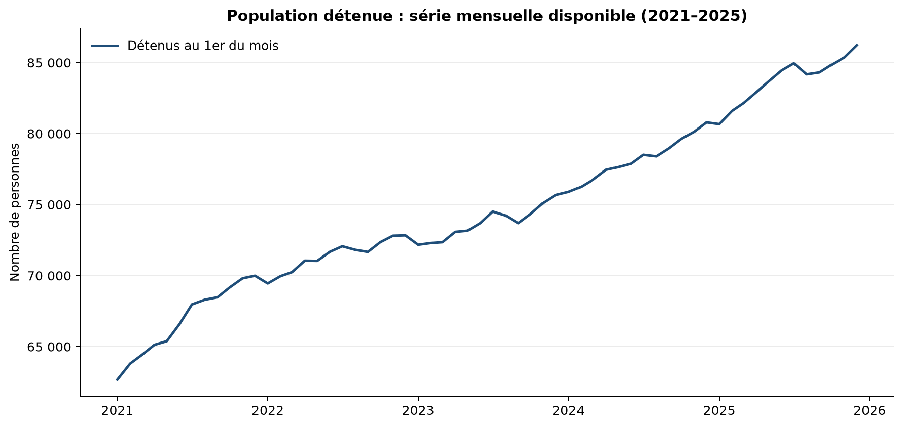
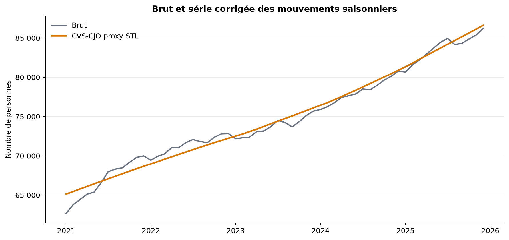
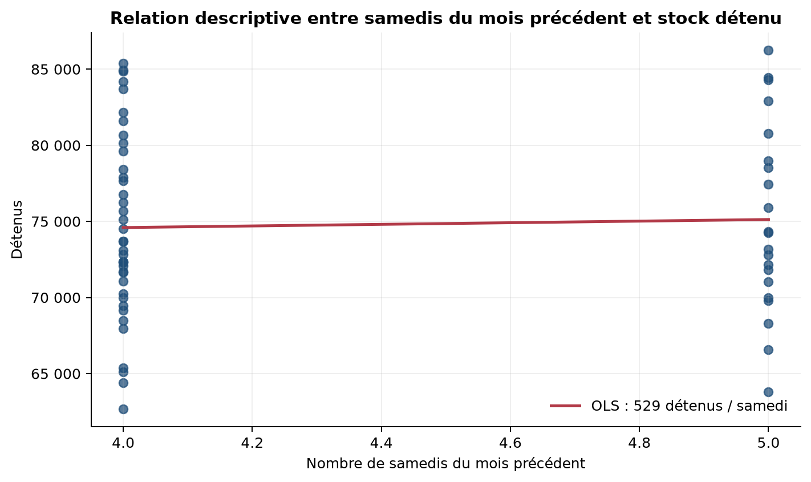
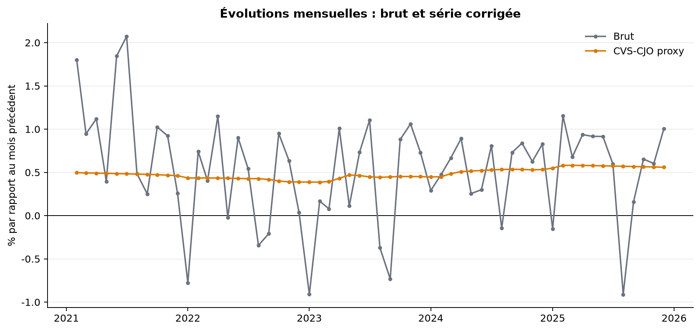

## Chapô

Le stock de personnes détenues au 1er du mois combine une tendance de fond et des mouvements calendaires. Cette note met à disposition une chaîne reproductible à partir des publications mensuelles de la Direction de l’administration pénitentiaire.

## Trois messages clés

1. La série mensuelle extraite couvre 2021–2025, tandis que la série annuelle Insee permet de replacer le niveau dans une perspective 2000–2025.
2. La correction par STL, utilisée ici comme proxy de rendu, lisse les mouvements réguliers sans effacer les ruptures importantes, notamment la période Covid.
3. Dans cette extraction, l’association linéaire entre le nombre de samedis du mois précédent et le stock est faible et non significative. Le régresseur doit donc être validé dans un modèle X-13 complet avant toute interprétation.

## Encadré méthodologique

Les données brutes sont conservées sans modification dans `data/raw/`. Les variables sont harmonisées par date et nombre de personnes détenues. Le nombre de samedis utilisé pour le mois m est celui du mois m−1, conformément à l’hypothèse métier. La chaîne R tente X-13 avec régresseur externe et outliers AO/LS ; une moyenne mobile est utilisée pour un rendu de secours lorsque l’exécutable X-13 n’est pas disponible.

**Source :** [Ministère de la Justice — statistiques mensuelles](https://www.justice.gouv.fr/documentation/etudes-et-statistiques/statistiques-mensuelles-population-detenue-ecrouee-9), [Insee — administration pénitentiaire](https://www.insee.fr/fr/statistiques/2382579).
