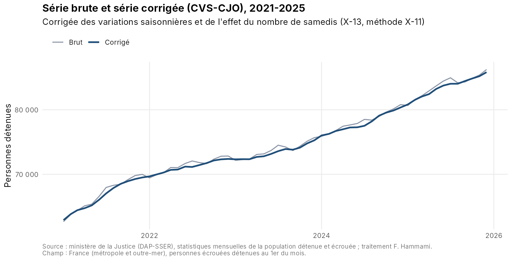
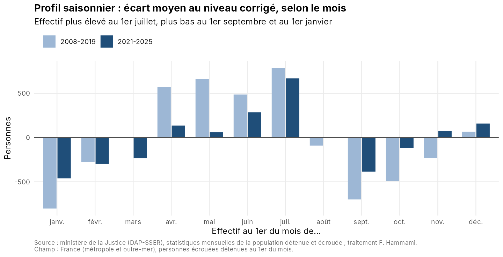

```{r}
#| include: false
knitr::opts_chunk$set(echo = FALSE, warning = FALSE, message = FALSE)
library(dplyr); library(readr); library(lubridate)
fr  <- function(x, d = 0) formatC(x, format = "f", digits = d, big.mark = " ", decimal.mark = ",")
pct <- function(x) paste0(ifelse(x > 0, "+", ""), fr(x, 1), " %")

serie <- read_csv("../data/clean/serie_longue_detenus.csv", show_col_types = FALSE)
cvs   <- read_csv("../data/clean/serie_cvs.csv", show_col_types = FALSE)
comp  <- read_csv("../output/comparaison_modeles.csv", show_col_types = FALSE)
insee <- read_csv("../output/controle_insee.csv", show_col_types = FALSE)

dernier <- cvs |> filter(date == max(date))
aout    <- cvs |> filter(date == ymd("2025-08-01"))
sept    <- cvs |> filter(date == ymd("2025-09-01"))
profil  <- cvs |> filter(periode == "2021-2025") |> group_by(m = month(date)) |> summarise(s = mean(saisonnalite))
amplitude <- max(profil$s) - min(profil$s)
recent  <- comp |> filter(periode == "2021-2025")
ancien  <- comp |> filter(periode == "2008-2019")
sur_un_an <- 100 * (dernier$detenus / cvs$detenus[cvs$date == ymd("2024-12-01")] - 1)
```

**Au 1er décembre 2025, `r fr(dernier$detenus)` personnes sont détenues en France, soit `r pct(sur_un_an)` en un an.** D'un mois à l'autre, l'effectif brut varie aussi pour des raisons saisonnières : il est plus élevé au 1er juillet et plus bas au 1er septembre et au 1er janvier. Corriger la série de ces variations change la lecture de certains mois.

## Trois messages clés

1. **Une saisonnalité marquée.** Sur 2021-2025, l'écart entre le mois le plus haut (1er juillet) et le mois le plus bas (1er janvier) atteint en moyenne `r fr(amplitude)` personnes.
2. **Une baisse estivale qui n'en est pas une.** Au 1er août 2025, l'effectif brut recule de `r fr(abs(aout$evol_brute), 1)`&nbsp;% ; une fois corrigée, la série est stable (`r pct(aout$evol_corrigee)`). Au 1er septembre, la hausse brute (`r pct(sept$evol_brute)`) sous-estime la hausse corrigée (`r pct(sept$evol_corrigee)`).
3. **Un effet « samedis » faible.** Le nombre de samedis du mois précédent n'a pas d'effet significatif sur 2008-2019 (p = `r fr(ancien$p_value, 2)`). Sur 2021-2025, il est à la limite de la significativité (`r fr(recent$coef_samedis)` personnes par samedi supplémentaire, p = `r fr(recent$p_value, 2)`), soit moins de 0,1&nbsp;% de l'effectif.







## Effet du nombre de samedis : comparaison des modèles

```{r}
comp |>
  transmute(`Période` = periode, `Mois` = nb_mois,
            `Effet d'un samedi (personnes)` = fr(coef_samedis, 1),
            `Écart-type` = fr(ecart_type, 1), `p-value` = fr(p_value, 3),
            `AICc sans` = fr(aicc_sans, 1), `AICc avec` = fr(aicc_avec, 1),
            `Modèle retenu` = modele_retenu) |>
  knitr::kable(align = "lrrrrrrl")
```

Le régresseur est conservé uniquement s'il améliore le critère d'information (AICc). Aucune saisonnalité résiduelle n'est détectée dans les séries corrigées (test QS).

## Encadré méthodologique

- **Données.** Statistiques mensuelles de la population détenue et écrouée (ministère de la Justice, DAP puis SSER). Chaque publication contient un tableau sur deux ans : en combinant les `r length(list.files("../data/raw", "\\.xlsx?$"))` fichiers disponibles, on reconstitue une série de `r nrow(serie)` mois, de janvier 2008 à décembre 2025. Quand un mois figure dans plusieurs publications, la plus récente est retenue.
- **Trou de série.** Les fichiers d'avril 2019 à décembre 2020 ne sont pas disponibles dans ce dépôt. Cette période, qui inclut la forte baisse liée à la crise sanitaire, n'est pas imputée : les deux périodes continues (2008-2019 et 2021-2025) sont désaisonnalisées séparément.
- **Désaisonnalisation.** X-13-ARIMA-SEATS, méthode X-11, via le package R `seasonal`. Le stock étant mesuré au 1er du mois, le régresseur calendaire est le nombre de samedis du mois **précédent**.
- **Contrôles.** Jusqu'en 2019, la série reconstituée est identique à l'effectif au 1er janvier publié par l'Insee. Depuis 2021, elle le dépasse de `r fr(min(insee$ecart[insee$annee >= 2021]))` à `r fr(max(insee$ecart[insee$annee >= 2021]))` personnes, car l'Insee exclut désormais les collectivités d'outre-mer.
- **Rupture de nomenclature.** Depuis 2020-2021, les condamnés-prévenus sont isolés ; auparavant, ils étaient surtout comptés parmi les prévenus. Le total est comparable, pas la ventilation.

## Limites et prolongements

- Compléter la série 2019-2020 en ajoutant les fichiers manquants, puis traiter la crise sanitaire par des points aberrants (changement de niveau).
- Reproduire la désaisonnalisation avec JDemetra+ (packages `rjd3x13` / `rjd3tramoseats`) et comparer.
- Tester l'effet calendaire sur les **flux** (entrées et sorties de détention), où il devrait être plus visible que sur le stock.

*Source : ministère de la Justice (DAP-SSER), statistiques mensuelles de la population détenue et écrouée ; Insee. Traitement : Fatma Hammami. Les définitions officielles ne sont pas modifiées.*
